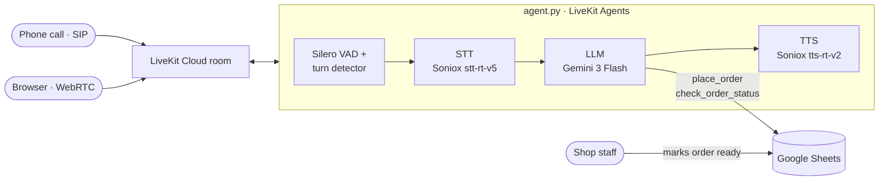

# 🍜 Thai Voice Ordering Agent

A real-time **Thai-speaking voice agent** that answers the phone for a noodle shop. It takes pickup orders,
applies promotions, writes orders to Google Sheets, and tells customers when their food is ready.
Callers can reach it over a **real phone line (SIP)** or in the **browser (WebRTC)**.


## What it does

- **Natural Thai conversation over the phone or the web.** Streaming speech-to-text, LLM and text-to-speech,
  with end-of-turn detection, barge-in (callers can interrupt), and shop ambience in the background.
- **Takes orders end to end.** Handles sizes (ธรรมดา / พิเศษ) and requests such as "ไม่ใส่ผัก", reads the order back,
  confirms the phone number digit by digit, then places it.
- **Never lets the LLM do the maths.** Prices, sizes and promotions (minimum spend, day of the week) are calculated
  in Python.
- **Connects to a real workflow.** Orders land in a Google Sheet. Staff change the status to `เสร็จแล้ว`, and
  customers can call back and ask "เสร็จหรือยังคะ".
- **Swappable speech stack.** Soniox cloud STT/TTS by default, or **fully local Thai STT and TTS on CPU**
  through custom LiveKit adapters.

## Demo conversation

An actual exchange from a test run (text mode, Gemini through LiveKit Inference):

| | Thai | English |
| --- | --- | --- |
| 🧑 | ขอหมี่ไก่ฉีกธรรมดา 1 ชาม ไม่ใส่ผัก กับหมี่คลุกพิเศษ 1 ชามค่ะ | One regular shredded-chicken noodle, no veggies, and one large noodle with old-style sauce. |
| 🤖 | รับทราบค่ะ หมี่ไก่ฉีกธรรมดาไม่ใส่ผัก 1 และหมี่คลุกซอสโบราณพิเศษ 1 นะคะ รับน้ำพริกกากหมูไปทานคู่กันด้วยไหมคะ | Got it: one regular, no veggies, and one large. Would you like chilli paste with crispy pork on the side? |
| 🧑 | แค่นี้ค่ะ ชื่อมะลิ เบอร์ 0812345678 | That's all. Name's Mali, phone 0812345678. |
| 🤖 | ทวนรายการนะคะ … เบอร์โทร ศูนย์ แปด หนึ่ง สอง สาม สี่ ห้า หก เจ็ด แปด ถูกต้องไหมคะ | Reads the order back, then the phone number digit by digit. Is that right? |
| 🧑 | ถูกต้องค่ะ ยืนยันเลย | Yes, please confirm. |
| ⚙️ | `place_order(...)` → *ออเดอร์ที่ 1 ยอดชำระ 148 บาท มารับที่ร้านได้ในอีกประมาณ 15 นาที* | Order #1, 148 baht, ready for pickup in about 15 minutes. |

Later, after staff mark the order ready in the sheet:

| | Thai | English |
| --- | --- | --- |
| 🧑 | สั่งหมี่ไว้ เสร็จหรือยังคะ | I ordered noodles. Are they ready? |
| 🤖 | เดี๋ยวเช็กสถานะให้เลยนะคะ ขอเบอร์โทรที่ใช้สั่งหน่อยค่ะ | Let me check. What number did you order with? |
| ⚙️ | `check_order_status("0812345678")` → *สถานะ: เสร็จแล้ว* | Status: ready |
| 🤖 | …ทำเสร็จเรียบร้อยแล้วค่ะ แวะมารับที่ร้านได้เลยนะคะ | It's ready. Come pick it up any time. |

## Architecture



| Layer | Default | Alternative |
| --- | --- | --- |
| Transport | LiveKit Cloud (WebRTC + SIP) | |
| Speech-to-text | Soniox `stt-rt-v5` (Thai + English) | Local [Typhoon ASR Nemotron 0.6B](https://huggingface.co/wannaphong/typhoon-asr-streaming-nemotron-0.6b-int4-onnx) via PyThaiASR (CPU) |
| LLM | Gemini 3 Flash via [LiveKit Inference](https://docs.livekit.io/agents/models/llm/inference/gemini/) | Any LiveKit Inference model (`LLM_MODEL`) |
| Text-to-speech | Soniox `tts-rt-v2`, voice Emma | Local [FastThaiG2P](https://github.com/awslabs/FastThaiG2P) + Kokoro-82M via PyThaiTTS (CPU) |
| End of turn | Silero VAD + LiveKit turn detector `v1-mini` (local) | |
| Orders | Google Sheets (gspread) | `orders.jsonl` |

## Engineering notes

- **Tools the LLM can't get wrong.** The agent has three tools: `place_order`, `check_order_status` and `end_call`.
  Menu items in `place_order` are an enum generated from `menu.py`, so the model can only order real dishes, and
  totals are computed in code rather than by the model.
- **Thai streaming TTS adapter** ([`thai_tts.py`](thai_tts.py)). This wraps PyThaiTTS as a LiveKit TTS. PyThaiTTS's
  own text splitter cut the text at every space, so each phrase got its own intonation and the speech sounded
  choppy. The adapter now groups the LLM's streamed text into sentences ending in ค่ะ/คะ/ครับ:
  - the same reply went from 13.1 s of choppy audio to 11.2 s with natural pauses
  - first audio arrives in about 0.35 s on a laptop CPU
- **Streaming STT for a model without endpointing** ([`thai_stt.py`](thai_stt.py)). Typhoon Nemotron decodes
  0.56 s chunks but can't tell when the speaker has stopped. A built-in VAD feeds it audio only while the caller
  speaks (plus 0.6 s from just before), streams interim text, and sends the final transcript 0.6–0.75 s after
  speech ends.
- **Latency profiling.** Each stage was measured. Gemini on a free-tier API key (5 requests/min) took 2.65 s
  to its first token. Moving to LiveKit Inference with minimal reasoning brought that to about 1.4 s median in
  benchmarks. A keyboard-typing sound fills the remaining wait while the agent thinks.

## Project structure

| File | What it does |
| --- | --- |
| [`agent.py`](agent.py) | The voice agent: picks STT/TTS providers, turn detection, background audio. Joins every new room |
| [`systemprompt.py`](systemprompt.py) | Persona and conversation rules (menu and promotions are filled in from `menu.py`) |
| [`menu.py`](menu.py) | Shop info, menu, prices and promotions |
| [`tools.py`](tools.py) | `place_order`, `check_order_status`, `end_call` |
| [`orders_store.py`](orders_store.py) | Saves and reads orders in Google Sheets (or `orders.jsonl`) |
| [`thai_stt.py`](thai_stt.py) / [`thai_tts.py`](thai_tts.py) | Local Thai STT/TTS adapters for LiveKit |
| [`web/`](web) | Token server and a one-page browser client with a live transcript |
| [`sip/`](sip) | Inbound trunk and dispatch rule for phone calls |
| [`Dockerfile`](Dockerfile), [`docker-compose.yml`](docker-compose.yml) | Container image plus the agent and web services |

## Getting started

You need [uv](https://docs.astral.sh/uv/), a free [LiveKit Cloud](https://cloud.livekit.io) project and a
[Soniox](https://console.soniox.com) API key. Gemini runs through LiveKit Inference, so no Google API key is needed.

```bash
cp .env.example .env            # add your LiveKit and Soniox keys
uv sync
uv run agent.py download-files  # Silero VAD weights

uv run agent.py console         # talk to it from your terminal
```

Browser demo (WebRTC):

```bash
uv run agent.py dev                          # terminal 1
uv run uvicorn web.server:app --port 8000    # terminal 2, then open http://localhost:8000
```

<details>
<summary><b>Phone calls (SIP)</b></summary>

Install the LiveKit CLI and link it to your project:

```bash
brew install livekit-cli
lk cloud auth
```

**Quickest test:** rent the free US number included with every LiveKit Cloud plan (Dashboard → Telephony →
Phone Numbers), then create the dispatch rule:

```bash
lk sip dispatch create sip/dispatch-rule.json
```

**Thai number (+66):** LiveKit Phone Numbers are US-only for now, so use a SIP provider such as
[Telnyx](https://telnyx.com/phone-numbers/thailand). A *National* number can be registered with a personal ID,
and approval takes about 72 h. Point the provider at your LiveKit SIP URI (Settings → SIP URI), then:

```bash
lk sip inbound create sip/inbound-trunk.json   # put your number in this file first
lk sip dispatch create sip/dispatch-rule.json
```

Every call gets its own `call-xxxx` room and the agent joins it automatically. For a free test without a number,
call the SIP URI from a softphone such as [Linphone](https://www.linphone.org/) using the trunk's username and password.
</details>

<details>
<summary><b>Orders in Google Sheets</b></summary>

Without this, orders are saved to `orders.jsonl`.

1. In [Google Cloud Console](https://console.cloud.google.com), enable the **Google Sheets API**, create a
   **service account** and save its JSON key as `google-service-account.json` in this folder.
2. Create a Google Sheet and share it with the service account's email as **Editor**.
3. Set `GOOGLE_SHEET_ID` in `.env` (the part of the sheet URL between `/d/` and `/edit`).

The header row is created automatically:

| order_no | created_at | customer_name | phone | items | total | status |
| --- | --- | --- | --- | --- | --- | --- |

New orders start as `กำลังทำ`. Change the status to `เสร็จแล้ว` when the food is ready.
</details>

<details>
<summary><b>Local STT / TTS (no cloud speech)</b></summary>

Set either provider to `"local"` near the top of `agent.py`:

```python
STT_PROVIDER = "local"   # PyThaiASR Typhoon Nemotron 0.6B (INT4), Thai only
TTS_PROVIDER = "local"   # PyThaiTTS FastThaiG2P (Kokoro-82M)
```

Download the models once (~1 GB) and smoke-test them:

```bash
uv run python thai_tts.py           # TTS model (~330 MB), writes test.wav
uv run python thai_stt.py test.wav  # ASR model (~700 MB), transcribes test.wav
```

Both models together use about 1.5 GB of RAM per process. The agent keeps one process warm.
</details>

<details>
<summary><b>Docker</b></summary>

```bash
docker compose up --build
```

This runs two containers from one image:
- **`agent`** connects out to LiveKit Cloud, so no ports need opening.
- **`web`** serves the browser demo on http://localhost:8000.

For local STT/TTS, set `LOCAL_MODELS=1` in `.env` to bake the models into the image, and give Docker at least 4 GB
of memory. For Google Sheets, mount the service account key into the agent container (see `docker-compose.yml`).
</details>

## Configuration

| Variable | Purpose |
| --- | --- |
| `LIVEKIT_URL`, `LIVEKIT_API_KEY`, `LIVEKIT_API_SECRET` | LiveKit Cloud project. Also covers Gemini through LiveKit Inference |
| `SONIOX_API_KEY` | Soniox STT and TTS |
| `SONIOX_TTS_VOICE` | TTS voice (default `Emma`; every Soniox voice speaks Thai) |
| `LLM_MODEL` | LiveKit Inference model (default `google/gemini-3-flash-preview`) |
| `GOOGLE_SHEET_ID`, `GOOGLE_SERVICE_ACCOUNT_FILE` | Google Sheet for orders |
| `LOCAL_MODELS` | Docker only: `1` bakes the local STT/TTS models into the image |

To use it for a different shop, edit `menu.py` (name, hours, menu, promotions) and the persona in `systemprompt.py`.

## Limitations

- The menu, prices and shop details are demo data.
- LiveKit's `v1-mini` turn detector isn't trained on Thai, so it falls back to its English threshold. It can be
  tuned per language in `agent.py`.
- Order numbers come from the sheet's row count. That's fine for a demo, but not safe for many simultaneous orders.
- Customers look up an order by phone number alone, with no further verification.
- Background audio isn't played in `console` mode, which is a LiveKit limitation. Use the web demo or a phone call.

## Acknowledgements

[LiveKit Agents](https://github.com/livekit/agents) · [Soniox](https://soniox.com) ·
[Google Gemini](https://ai.google.dev) · [PyThaiNLP](https://github.com/PyThaiNLP) (PyThaiTTS, PyThaiASR) ·
[FastThaiG2P](https://github.com/awslabs/FastThaiG2P) · [Typhoon ASR](https://huggingface.co/wannaphong/typhoon-asr-streaming-nemotron-0.6b-int4-onnx)
